<div align="center">



<br/>


</div>

---

## ✿ About Me

```text
(๑˃ᴗ˂)ﻭ  Name       : Moulishaa Dewangan
(◕‿◕✿)  Role       : Student / Developer
(｡•̀ᴗ-)✧ Learning   : React, Python, Rust
(≧▽≦)   Fun fact   : I can't code without lo-fi music
(づ｡◕‿‿◕｡)づ Fav anime: your favourites here
```

## ✦ Currently

| | |
|---|---|
| 🌸 **Working on** | your project name |
| 📚 **Learning** | the new thing |
| 🎧 **Listening to** | lo-fi / anime OSTs |
| 💬 **Ask me about** | web dev, anime, open source |

## ✦ Tech Stack

<div align="center">


</div>

## ♡ GitHub Stats

<div align="center">

<a href="https://github.com/dmoulishaa-27">


</a>

<sub>If the cards above don't load, the free stats service is just busy. The rest of the page still works.</sub>

</div>

## ☆ Featured Projects

| Project | Description | Tech |
|---|---|---|
| [✧ Project One](https://github.com/dmoulishaa-27/project-one) | Short, cute description | Python |
| [✧ Project Two](https://github.com/dmoulishaa-27/project-two) | Short, cute description | React |

## ✉ Connect With Me

<div align="center">

[](https://twitter.com/dmoulishaa-27)
[](https://linkedin.com/in/dmoulishaa-27)
[](mailto:you@example.com)

<br/>


</div>
